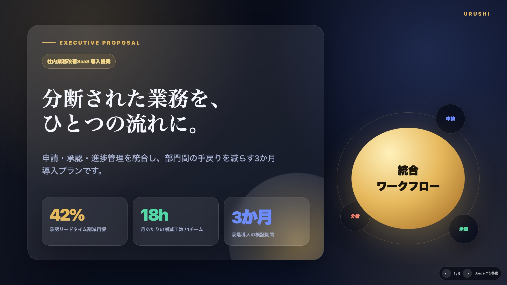

# Urushi

自然言語で書いたスライド概要から、AI（Anthropic Messages API）が1ファイル完結のリッチなHTMLスライドデッキを生成するプロトタイプです。

## 画面イメージ




## いまできること

- ローカルWeb UIで概要を入力し、生成されたスライドをiframeでプレビュー
- 生成HTMLのダウンロード、別タブ表示
- CLIから `out/<timestamp>.html` への書き出し
- 16:9（1920x1080）固定キャンバス、キーボードページ送り、ページ番号、アニメーション、印刷用CSSをLLMに強制するsystem prompt
- `ANTHROPIC_API_KEY` がない環境でも、同梱サンプルでUIとCLIの動作確認

## セットアップ

Node.js 20以上が必要です。

```sh
npm install
cp .env.example .env
```

`.env` にAnthropic APIキーを設定します。

```sh
ANTHROPIC_API_KEY=sk-ant-...
```

APIキーがなくても起動できます。その場合はLLMを呼ばず、[`examples/sample.html`](examples/sample.html) を返すモックモードになります。

## Web UI

```sh
npm run dev
```

起動後、<http://localhost:3333> を開きます。ポートは `.env` または環境変数 `PORT` で変更できます。

1. 左側のテキストエリアに作りたいスライドの概要を入力
2. 「スライドを生成」を押す
3. 右側のプレビューで確認
4. 「HTMLをダウンロード」で1ファイルHTMLを保存

サンプルだけを確認したい場合は「サンプルで確認」をオンにするか、[`examples/sample.html`](examples/sample.html) を直接開いてください。

## 一時公開（GitHub Pages / BYOK）

PR #1 のレビュー用に、静的版を一時公開しています。

<https://yuto90.github.io/urushi/>

この公開版は静的ホスティングのためNodeサーバーは使いません。閲覧者が自分のAnthropic APIキーを入力すると、ブラウザからAnthropic API（`api.anthropic.com`）へ直接リクエストします（BYOK）。GitHub Pagesや第三者サーバーにキーは送信されません。キーは通常sessionStorageのみに保持され、「この端末に保存する」をチェックした場合だけlocalStorageに保存されます。APIキーなしでも「サンプルを表示」でデモデッキを確認できます。

Pages用の静的ファイルは次で `dist-pages/` にビルドできます。

```sh
npm run build:pages
```

## CLI

```sh
npm run cli -- "新しいSaaS導入提案を経営層向けに5枚で"
```

またはビルド済みファイルを直接実行します。

```sh
node dist/cli.js "新しいSaaS導入提案を経営層向けに5枚で"
```

生成物は `out/<timestamp>.html` に書き出されます。LLMを呼ばずサンプルを出す場合は次のようにします。

```sh
node dist/cli.js --sample "動作確認"
```

このリポジトリをnpmパッケージとしてインストールした環境では、`npx urushi "概要"` でも実行できます。

## 環境変数

| 変数 | 既定値 | 説明 |
| --- | --- | --- |
| `ANTHROPIC_API_KEY` | なし | Anthropic APIキー。未設定時はサンプルモック |
| `URUSHI_MODEL` | `claude-sonnet-5-5` | Messages APIで使うモデル |
| `PORT` | `3333` | Web UIのポート |

`.env` は `.gitignore` 済みです。実際のキーはコミットしないでください。

## 出力HTMLの方針

生成HTMLは次の条件をsystem promptで強制しています。

- CSS/JSをインラインした1ファイル完結
- 1920x1080の16:9キャンバスを画面にフィットさせてスケール
- ← / → / Space / PageUp / PageDownでページ送り、ページ番号表示
- 要素の順次出現、バーアニメーション、カウントアップなど読みやすさ優先のアニメーション
- 色・書体・余白などをCSSカスタムプロパティのデザイントークンに集約
- `@media print` による1スライド1ページ印刷

LLMの応答からHTML部分だけを抽出する簡単な後処理（コードフェンス除去など）を入れています。

## ファイル構成

```text
src/
  anthropic.ts    Anthropic Messages API呼び出し
  cli.ts          CLIエントリーポイント
  config.ts       .envと環境変数の読み込み
  generate.ts     生成処理のオーケストレーション
  postprocess.ts  LLM応答からHTMLを抽出
  prompt.ts       system prompt / user prompt
  server.ts       ローカルWebサーバー
public/           ローカルWeb UI
pages/            GitHub Pages用の静的HTML/CSS
scripts/          Pagesビルドスクリプト
examples/sample.html  モック兼デモ用の手書きサンプルデッキ
```

## 検証

```sh
npm run typecheck
npm run build
npm run cli -- --sample "動作確認"
npm run build:pages
```

## 未対応・今後の余地

- 意味スキーマ（結論・比較・因果・手順・一覧など）の構造化入力
- レイアウトの機械可読な検証、スクリーンショットによる自己修正ループ
- PDF / PPTX書き出し
- 生成履歴、再編集、部分修正
- 認証・複数ユーザー対応
